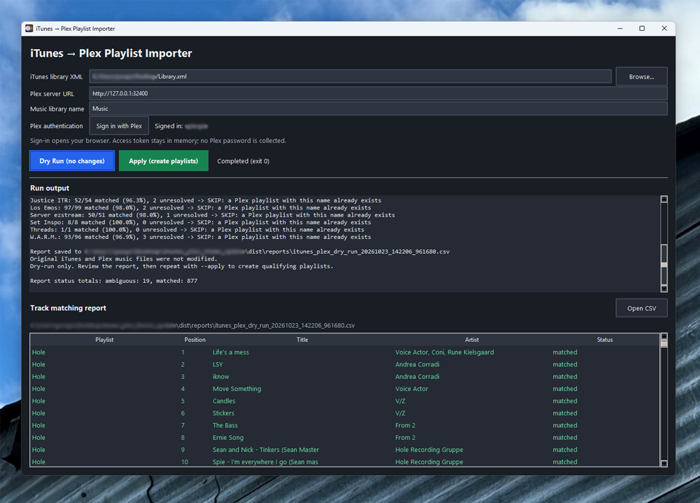

# iTunes → Plex Playlist Importer

A small Windows desktop app that imports **regular iTunes playlists** into an existing **Plex music library**. It matches tracks already in Plex, previews the results before making changes, and creates qualifying playlists through the Plex API.

The app is built with Python and Tkinter. It supports **Sign in with Plex**, automatic Windows **light/dark mode**, and a CSV track-matching report.

> **Important:** This tool imports **playlists**, not audio files. Your music must already be indexed in a Plex music library. Start with **Dry Run** and inspect the report before selecting **Apply**.

→ [Download the latest Windows release](https://github.com/seanpierce/iTunesPlexImporter/releases/tag/1.0.0)



## But why?

Plex is buggy, or their team simply doesn't have the time for this feature. There have been numerous reports of users being unable to migrate playlists from iTunes to Plex. Many users have followed various posts describing the potential method of achieving this, but with no success. I am one of those users. 

## Features

- Select an exported iTunes library XML file with a file picker.
- Connect to Plex at `http://127.0.0.1:32400` by default, or provide another server URL.
- Specify the Plex music library name (`Music` by default).
- Authenticate via Plex in your browser; the GUI does not ask for your Plex password.
- **Dry Run:** preview track matches and skipped playlists without changing Plex.
- **Apply:** create eligible playlists after confirmation.
- Match tracks by title, artist, album, filename, and—where helpful—duration.
- Preserve the order of matched tracks, including repeated entries.
- Skip playlists whose names already exist in Plex.
- View the run log, inspect matches in the GUI, and open a CSV report.
- Follow the Windows app light/dark theme; use distinct blue **Dry Run** and green **Apply** buttons.

## Requirements

### Running the source code

- Windows 10 or 11
- Python 3 with Tkinter (included with most standard Windows Python installers)
- [`plexapi`](https://python-plexapi.readthedocs.io/)
- An accessible Plex Media Server with an existing music library
- An exported iTunes library XML file
- Internet access for browser-based Plex account sign-in

The **compiled `.exe`** bundles Python, Tkinter, and `plexapi`; recipients do **not** need to install these separately.

## Getting started

### 1. Export your iTunes library

In iTunes on Windows, choose **File → Library → Export Library** and save the resulting `.xml` file. Export the **library**, rather than just one selected playlist, to include the regular playlists you want to migrate.

### 2. Install and launch

Clone or download the repository, then open PowerShell in its folder:

```powershell
py -m pip install --upgrade plexapi
py .\itunes_plex_gui.py
```

### 3. Connect to Plex

1. Click **Browse** and select your exported library XML file.
2. Leave the Plex server URL as `http://127.0.0.1:32400` if Plex Media Server is running on the same PC. Otherwise, enter its reachable URL (for example, `http://192.168.1.50:32400`).
3. Enter your Plex music library's exact name (default: `Music`).
4. Click **Sign in with Plex**, complete the browser authorization, and return to the app.

The Plex token is held in memory for the session and is not written to the CSV report. The app does not collect your Plex password. You normally sign in again after restarting the app. You can alternatively supply a token with the `PLEX_TOKEN` environment variable.

### 4. Preview, then import

1. Click **Dry Run**. The app indexes Plex's existing music tracks and compares them with the playlists in your XML file.
2. Review the log and matching report, especially tracks marked `missing` or `ambiguous`.
3. Click **Apply** and confirm to create eligible playlists in Plex.
4. Open Plex or Plexamp and check your imported playlists.

By default, a playlist must have **at least 95% of its tracks matched** to be created. Unresolved tracks are not included in the resulting Plex playlist. A playlist already present in Plex is **skipped**, not updated or overwritten.

## Reports

Each GUI run creates a separate CSV file in a `reports` folder **beside the executable** (or beside the source files when running from Python). Keep the executable in a writable location, such as your Desktop or Documents folder.

Reports include the playlist name, track position, iTunes track ID, track title, artist, album, match status, and Plex rating key when available.

| Status | Meaning |
| --- | --- |
| `matched` | One corresponding Plex track was identified. |
| `missing` | No corresponding Plex track was found. |
| `ambiguous` | More than one plausible Plex track was found. |
| `not_in_xml` | The playlist references a track absent from the exported XML track table. |

Review the CSV even if the overall match percentage is high—metadata matching cannot guarantee every match is the correct recording or edition.

## Build a standalone Windows executable

Build **on Windows** using [PyInstaller](https://pyinstaller.org/):

```powershell
py -m pip install --upgrade plexapi pyinstaller

py -m PyInstaller `
    --noconfirm `
    --clean `
    --onefile `
    --windowed `
    --name "iTunesPlexImporter" `
    --icon "iTunesPlexImporter.ico" `
    --add-data "iTunesPlexImporter.ico;." `
    --add-data "iTunesPlexImporter.png;." `
    itunes_plex_gui.py
```

The finished file will be at:

```text
dist\iTunesPlexImporter.exe
```

`--icon` sets the executable icon; the two `--add-data` options package the image files that Tkinter uses for the application window and taskbar. The output is a standalone `.exe`, so users do not need Python or PyInstaller installed.

An unsigned, self-built executable may trigger Windows SmartScreen or antivirus warnings. Test releases on another Windows machine before distributing them. If Explorer displays a previous icon, try renaming the `.exe` to bypass the icon cache.

## Optional: command-line importer

The repository also includes `itunes_to_plex.py`, which can be run directly without the GUI. It defaults to dry-run mode and requires a Plex token. For example:

```powershell
$env:PLEX_TOKEN = "YOUR_PLEX_TOKEN"

py .\itunes_to_plex.py `
    --xml "C:\Users\YourUsername\Desktop\Library.xml" `
    --url "http://127.0.0.1:32400" `
    --library "Music"
```

When the report looks correct, add `--apply` to create qualifying playlists. Additional useful options:

```text
--playlist "Playlist Name"   Process only one exact playlist name
--min-match 0.95           Minimum matched fraction (0.0–1.0)
--report "report.csv"      Write the report to a custom path
--apply                     Create qualifying playlists
```

Run `py .\itunes_to_plex.py --help` for all options.

## Limitations and behavior

- **Regular playlists only:** iTunes Smart Playlists are excluded. Convert them to regular playlists in iTunes before exporting if you want to migrate them.
- **No music transfer:** the importer does not upload, copy, re-tag, or modify audio files.
- **No automatic synchronization:** importing once does not keep iTunes and Plex playlists in sync.
- **Existing playlists are skipped:** rerunning Apply does not update same-named playlists.
- **Matching depends on metadata:** renamed tracks, duplicate recordings, or mismatched library metadata may produce missing or ambiguous matches. Review the CSV.
- **Partial imports:** playlists meeting the match threshold can still omit unmatched entries.
- **Local network by default:** `127.0.0.1` only works when the Plex server is on the same machine. For another host, provide its address and ensure it is reachable.

## Troubleshooting

**Cannot connect to Plex**  
Check that Plex Media Server is running and that the URL includes the correct IP address and port (`32400`). If Plex runs locally, try opening `http://127.0.0.1:32400/web` in your browser.

**Library not found**  
Enter the music library's name exactly as shown in Plex, including capitalization and spaces.

**Plex sign-in doesn't finish**  
Make sure your browser can reach Plex's authentication service and that you complete the authorization before it expires. Retry the sign-in if necessary.

**Many tracks are missing or ambiguous**  
Confirm that the audio files are already in Plex, compare metadata between iTunes and Plex, and inspect the report for duplicate or differing releases.

**My playlist did not appear after Apply**  
Check the log. It may have been skipped because a same-named playlist already exists or because fewer than 95% of entries matched.

**GUI runs but displays a generic icon**  
Rebuild with the `--icon` and both `--add-data` arguments shown above. A cached Windows icon can also require renaming the executable.

## Project files

```text
itunes_plex_gui.py       # Tkinter desktop application
itunes_to_plex.py        # Playlist matching/import engine and CLI
iTunesPlexImporter.ico    # Windows executable/window icon
iTunesPlexImporter.png    # Tkinter runtime icon
README.md                # This documentation
```

## Notes on security

Plex authentication occurs through Plex's sign-in flow. Treat an access token as a credential: don't commit it to source control, include it in bug reports, or share it with anyone. Review the code and trust the source before running any executable received from another person.

This is an independent utility, not an official Apple or Plex product. iTunes, Apple, Plex, and Plexamp are trademarks of their respective owners.
